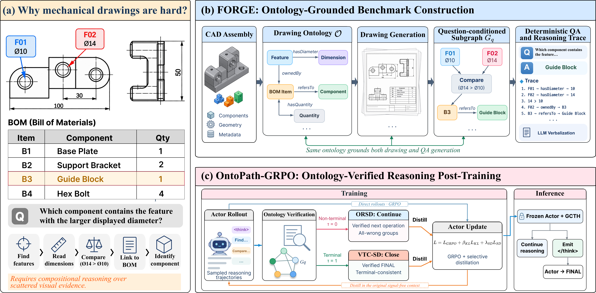

# FORGE: Ontology-Grounded Compositional Reasoning over Mechanical Engineering Drawings

<p align="center">
  
</p>

## Abstract

Mechanical engineering drawings require models to integrate geometric, component-level, and tabular information through structured relations. We introduce **FORGE**, a CAD-derived benchmark for ontology-grounded compositional reasoning over mechanical drawings, containing 31,307 QA pairs over 1,724 drawings. We further propose ontology-verified post-training with **Ontology-Routed Selective Distillation (ORSD)**, **Verified Terminal Closure Self-Distillation (VTC-SD)**, and a lightweight **Goal-Conditioned Terminality Head (GCTH)**. Across diverse open MLLMs, the strongest non-post-trained model reaches only 39.33% accuracy on the held-out Hard split. Our 4B model improves Hard accuracy from 37.45% to 70.41% while maintaining Standard accuracy at 92.94%. Analysis shows that the gains are concentrated on deeper compositional reasoning and arise from complementary improvements in routing, closure, and termination.

## Installation

Python 3.10+ is required.

```bash
python -m venv .venv
source .venv/bin/activate
pip install -e ".[vlm]"
```

For development and validation:

```bash
pip install -e ".[dev]"
pytest
ruff check src scripts integrations tests
```

Distributed actor training uses an external EasyR1/verl runtime and is not vendored in this repository. The repository also does not redistribute benchmark images, model weights, or training checkpoints. See [`docs/DATA_FORMAT.md`](docs/DATA_FORMAT.md) for the expected data schema.

## Training

### ORSD + VTC-SD

Validate the released training configuration:

```bash
python scripts/train_orsd_vtc.py \
  --config configs/forge_orsd_vtc_qwen3vl4b.yaml \
  --dry-run
```

Actual distributed training requires a user-provided EasyR1/verl runtime factory:

```bash
python scripts/train_orsd_vtc.py \
  --config configs/forge_orsd_vtc_qwen3vl4b.yaml \
  --runtime your_bridge:make_runtime
```

The runtime contract is documented in [`integrations/easyr1/README.md`](integrations/easyr1/README.md). The released configuration uses Standard-only SFT initialization and Hard-only ontology-verified post-training. Search-generated teacher continuations are used only for selective distillation and never inserted into GRPO rollouts.

### GCTH

Build verified train-only reasoning states from actor trajectories and ontology payloads:

```bash
python scripts/build_ontology_states.py \
  --qa user_data/train_trajectories.jsonl \
  --ontology user_data/train_ontologies.json \
  --tokenizer user_models/sft_actor \
  --output outputs/verified_train_states.jsonl
```

Fit the linear goal-conditioned terminality head on the frozen post-trained actor:

```bash
python scripts/train_terminality_head.py \
  --config configs/gcth_linear.yaml \
  --states outputs/verified_train_states.jsonl \
  --model user_models/sft_actor \
  --adapter user_models/final_adapter \
  --device cuda \
  --output outputs/gcth.json
```

Detailed training notes are available in [`docs/TRAINING.md`](docs/TRAINING.md).

## Evaluation

Run actor-only inference by omitting `--head`, or enable GCTH by supplying the trained head:

```bash
python scripts/run_gcth_inference.py \
  --input user_data/questions.jsonl \
  --model user_models/sft_actor \
  --adapter user_models/final_adapter \
  --head outputs/gcth.json \
  --config configs/gcth_linear.yaml \
  --device cuda \
  --output outputs/predictions.jsonl
```

Score predictions against deterministic canonical answers:

```bash
python scripts/evaluate_predictions.py \
  --gold user_data/evaluation_qa.jsonl \
  --predictions outputs/predictions.jsonl \
  --output outputs/scored.jsonl
```

The paper evaluation uses greedy decoding with a 4,096-token response budget. GCTH performs STOP-only control: it may close the reasoning block, but the same actor always generates the final answer. No ontology or verifier is used by GCTH at inference. See [`docs/INFERENCE.md`](docs/INFERENCE.md) for the causal replay contract.
